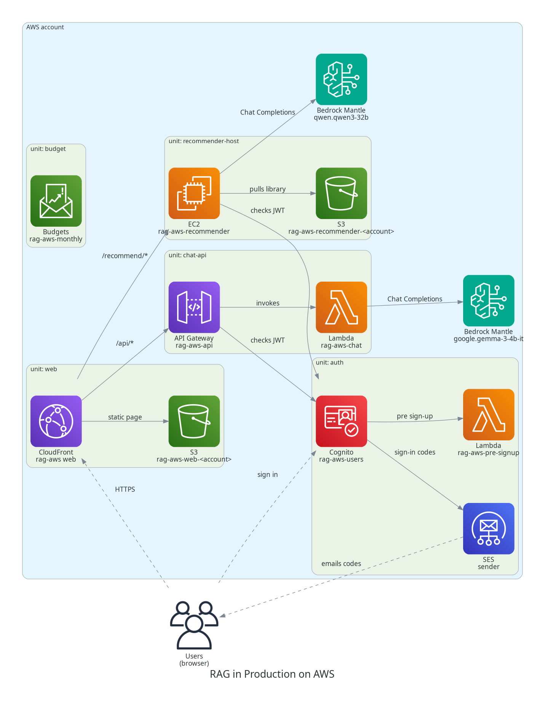

# Infrastructure

How the sign-in page and the anime recommender are deployed, on LocalStack and on real AWS. How the
recommender answers is in [README.md](README.md).

The infrastructure lives in [`infra/`](infra); the Lambdas' code lives in [`src/`](src):

| Path | Contents |
| --- | --- |
| `infra/docker-compose.yml` | LocalStack, which emulates AWS locally, and Phoenix, which traces the local RAG and the Lambdas on LocalStack (on AWS the traces go to Arize AX) |
| `infra/modules/s3-bucket/` | OpenTofu module for a private, versioned, encrypted S3 bucket, with tests in `tests/` |
| `infra/modules/auth/` | Cognito user pool with passwordless email-code sign-in, limited to allowed email domains; the pre sign-up Lambda's code is in `src/auth/` |
| `infra/modules/chat-api/` | HTTP API with a Cognito JWT authorizer and the api Lambda that queues questions and returns their answers; its code is in `src/chat/` |
| `infra/modules/container-registry/` | ECR repository for the recommender worker's image (scanned, encrypted, old builds expire) |
| `infra/modules/recommender/` | The worker Lambda (container image) fed by SQS with a dead-letter queue, the DynamoDB jobs and conversations tables, the bundle bucket and its version parameter, and alarms; its code is in `src/recommender/` |
| `infra/docker/recommender.Dockerfile` | The worker image: the recommender, its runtime dependencies and the ONNX MiniLM model |
| `infra/modules/web/` | Private S3 bucket and CloudFront for the page in [`web/`](web); `/api/*` is forwarded to the chat API |
| `infra/modules/budget/` | Monthly cost budget for the AWS account, emailing at 80 % actual and 100 % forecasted spend (real AWS only) |
| `infra/scripts/` | `local_flow.py` drives the local sign-in and chat flow; `build_*.sh` build the api zip and the worker image; `diagram.py` draws the architecture diagram |
| `infra/live/` | Terragrunt config; `live/local/` deploys to LocalStack, `live/aws/` to your real AWS account |
| `web/` | Static sign-in and chat page (plain HTML, CSS and JavaScript; no build step) |
| `src/chat/`, `src/auth/`, `src/recommender/` | Code of the api Lambda, the pre sign-up Lambda and the recommender worker; `src/tracing.py` is shared |
| `tests/` | Unit tests of the Lambdas and the recommender (`just test-unit`) |

Requires [Docker](https://www.docker.com/), [just](https://just.systems/), the
[AWS CLI](https://aws.amazon.com/cli/), [OpenTofu](https://opentofu.org/),
[Terragrunt](https://terragrunt.gruntwork.io/) and [uv](https://docs.astral.sh/uv/) (it runs
the scripts in `infra/scripts/` with their dependencies). `just aws-diagram` also needs
[Graphviz](https://graphviz.org/download/) (`dot`). The versions are pinned in
`infra/.opentofu-version` and `infra/.terragrunt-version`; [tenv](https://github.com/tofuutils/tenv)
picks them up automatically.

## LocalStack (local AWS)

Create a free account at [app.localstack.cloud](https://app.localstack.cloud), copy your auth
token from **Auth Tokens**, and put it in `infra/.env`:

```sh
cp infra/.env.example infra/.env   # then set LOCALSTACK_AUTH_TOKEN
just up                            # start LocalStack and wait until it is healthy
just status                        # list the emulated services
just aws s3 ls                     # any AWS CLI command, sent to LocalStack
just down                          # stop it
```

## OpenTofu and Terragrunt

```sh
just lint             # formatting checks and validation of every module
just test-unit        # module tests with mocked providers, plus the Lambda unit tests (no LocalStack)
just test-localstack  # creates and destroys a test bucket on LocalStack
just plan             # plan infra/live/local
just apply            # deploy the whole stack (bucket, sign-in, chat API, page) on LocalStack
just e2e              # apply, run the sign-in and chat checks, then destroy
just destroy          # remove everything from infra/live/local
```

Run `just` to see all recipes.

## Trying the whole flow locally

For the quickest start (one command, plus tracing in Phoenix), see
[Try the chat locally](TESTING.md#try-the-chat-locally-and-see-its-traces) in TESTING.md.

`infra/live/local/` deploys the same `auth`, `recommender-registry`, `recommender`, `chat-api` and
`web` units as `infra/live/aws/` (both share `infra/live/_units/`). The recommender unit builds the
worker image and pushes it to the registry before every plan and apply; publish a catalog bundle with
`just recommender-publish` (the fixture by default) before asking. LocalStack's Cognito has no passwordless sign-in, so locally
users get a fixed password ([`infra/scripts/local_flow.py`](infra/scripts/local_flow.py)) and the
email-code screens can only be tried on real AWS. Everything else is exercised: the pre sign-up
Lambda's domain check, the confirmation code sent through SES, the JWT authorizer, the queue, the
worker's container image, its bundle download from S3 and its version from SSM, DynamoDB, the alarms
and CloudFront's `/api/*` forwarding.

Locally the worker calls LocalStack's Bedrock (Converse), which runs `LOCALSTACK_BEDROCK_MODEL`
(default Llama 3.2 3B) with Ollama in its own container. `just up` gives that container the GPU once
`just gpu-setup` has made nvidia Docker's default runtime, since LocalStack accepts no `--gpus` flag
for it (seconds per answer; see [TESTING.md](TESTING.md)); otherwise it runs on CPU, in minutes, so the local worker gets a 900-second timeout. CI
answers with a deterministic stand-in instead (`RAG_LOCAL_MODEL_API=stub`), which checks the whole
path in seconds. Bedrock is part of LocalStack's paid plans, so the auth token must include it.

```sh
just apply                                   # deploy
just outputs                                 # page URL (open it in a browser), API URL, IDs
just signup me@student.uu.se                 # register; the code is read from LocalStack's SES inbox
just codes                                   # every code LocalStack has "emailed"
just recommender-publish                     # serve the fixture catalog (`full` for AniList)
just chat me@student.uu.se "Recommend anime like Orbitfall"  # ask through CloudFront, wait for the answer
just session me@student.uu.se                # paste the output in the page's browser console
                                             # to sign the page in, then use the chat box
just destroy
```

LocalStack doesn't apply CloudFront's security headers (CSP, HSTS) or check the token issuer
strictly; check those on AWS.

## Real AWS: sign-in page and chat

`infra/live/aws/` deploys a sign-in page where people with an allowed university email
(`@uu.se`, `@student.uu.se` by default) register and sign in with a one-time code sent to
their inbox, then reach the anime recommender. The api Lambda
([`src/chat/handler.py`](src/chat/handler.py)) queues each question; the worker
([`src/recommender/worker.py`](src/recommender/worker.py)) answers it with a Bedrock model: by default
Qwen3 32B through Chat Completions on bedrock-mantle, Bedrock's OpenAI-compatible endpoint. Its
quotas are separate from bedrock-runtime's, and the requests show up under the default project in
the console. The worker signs these requests with its IAM role, so there is no API key to store.
`RAG_BEDROCK_MODEL_ID` in `infra/.env` picks another model, and `RAG_BEDROCK_MODEL_API=converse`
switches to Converse on bedrock-runtime.

```text
browser ── CloudFront ──┬── /        → S3 (web/)
   │                    └── /api/*   → API Gateway (JWT authorizer) → api Lambda → DynamoDB job + SQS
   │                                                SQS (+ DLQ) → worker Lambda (ECR image) → Bedrock
   │                                                              ├── bundle: S3, version in SSM
   │                                                              └── answer + conversation: DynamoDB
   └── Cognito (email code; pre sign-up Lambda rejects other domains; codes sent through SES)
```



[`docs/architecture.png`](docs/architecture.png) is drawn by `just aws-diagram` from what is
deployed: each icon is a service in a unit's OpenTofu state, and each arrow means that service's
state refers to the other one (CloudFront's origins, the API's integration and authorizer,
Cognito's pre sign-up trigger, the chat Lambda's model). Run it again after `just aws-apply`
changes the services, and commit the new image.

One-time setup:

1. Sign in to your account with the AWS CLI, ideally through IAM Identity Center (`aws sso login`).
2. Fill in the "Real AWS" part of `infra/.env` (see `infra/.env.example`): `AWS_PROFILE`,
   `RAG_AWS_ACCOUNT_ID` and `RAG_SES_IDENTITY`. For a quick start, use your own email address
   as `RAG_SES_IDENTITY`; with a domain in Route 53, also set `RAG_ROUTE53_ZONE_ID`.
3. `just aws-bootstrap` creates the S3 bucket for the OpenTofu state.
4. `just aws-apply` deploys everything (CloudFront takes a few minutes). If you used an email
   address, click the verification link SES sends to it. The alarm emails (`RAG_BUDGET_EMAILS`)
   each get an SNS confirmation link too.
5. `just aws-recommender-publish` builds the full AniList bundle and serves it.
6. `just aws-outputs` prints the page URL.

New accounts start in the **SES sandbox**: codes only reach addresses verified in SES (at most
200 emails a day). Request production access in the SES console before inviting others, and set
`deletion_protection = "ACTIVE"` in `infra/live/aws/env.hcl` so registered users can't be deleted
by accident.

```sh
just aws-plan       # preview changes
just aws-apply      # deploy
just aws-outputs    # page URL, user pool and client IDs
just aws-destroy    # remove everything, including registered users
just web-dev        # serve web/ locally on http://localhost:8000 against the deployed API
just aws-diagram    # redraw docs/architecture.png from the deployed services
```

### The recommender on AWS

Why it is built this way, and what the spikes before building it found:

- **Asynchronous.** An answer takes several model calls (interpretation, planning, a grounded reply,
  sometimes a correction) and a cold start downloads the bundle, which can outlast API Gateway's
  30 seconds. So the api Lambda queues the question and returns at once, and the page polls.
- **Lambda, not a container service.** The worker runs only while there are questions, which fits the
  monthly budget; SQS's `maximum_concurrency` (2) caps parallel answers and Bedrock spend without
  reserving account concurrency. A cold start costs the image start, the bundle download (about
  2 GB for the full catalog, checksum-verified) and loading the catalog; warm containers keep it.
- **Embeddings in ONNX Runtime.** MiniLM's ONNX export gives the same vectors as
  sentence-transformers (cosine ≥ 0.9999999 on 1,000 AniList chunks), so the index built with
  either stays valid and the image needs no PyTorch.
- **JSON schemas are checked, not trusted.** LocalStack's Converse ignores `toolConfig` and
  constrained output, and on bedrock-mantle Gemma 3 4B accepts `response_format: json_schema` without
  following it; Qwen3 32B follows it strictly. Every structured step therefore validates the reply
  and asks once more with the validation error.
- **Releases without deploys.** A bundle version is a prefix in the bucket; the SSM parameter says
  which one is served, so publishing and rolling back is one parameter change.
- **Failures.** A busy or failing model, or a question the catalog can't ground, fails the job with
  a message the page shows (with the trace ID). Anything else is retried once, then the job is
  marked failed and the message goes to the dead-letter queue, which raises an alarm. Errors and
  slow answers (p95 above 80 % of the timeout) raise alarms too.

`just recommender-logs` follows the local worker's log; on AWS it is `/aws/lambda/rag-aws-recommender`.

### Traces in Arize AX

A Lambda in AWS can't reach the Phoenix on your machine, so on AWS the api Lambda and the worker send
their traces to [Arize AX](https://app.arize.com) instead: the same spans as on LocalStack, under the
project **rag-aws**. The Arize API key is kept in SSM Parameter Store as a SecureString
(`/rag-aws/arize-api-key`), never in `infra/.env`, the OpenTofu state or the Lambda's environment;
the Lambdas read it when they start and may read no other secret.

1. Set `RAG_ARIZE_SPACE_ID` in `infra/.env`: the ID after `/spaces/` in your Arize URL.
2. `just aws-arize-key` asks for the API key (Arize: Space Settings > API Keys) and stores it.
   Run it again to rotate the key; running Lambdas pick up the new one on their next cold start.
3. `just aws-apply`, then send a message and open the project in Arize.

Tracing stays off while `RAG_ARIZE_SPACE_ID` is empty. If no traces appear, the Lambda's log
(`/aws/lambda/rag-aws-chat` or `/aws/lambda/rag-aws-recommender` in CloudWatch) says why, e.g.
`Tracing off: could not read ...`.

## A second AWS account: only the budget

If you also call Bedrock by hand from another account, `infra/live/aws-mantle/` gives it the
same monthly budget as the chatbot's account (`RAG_BUDGET_LIMIT_USD`, `RAG_BUDGET_EMAILS`). Like
the original budget, it only sends emails and never stops anything. Set up a CLI profile for that
account with permission for AWS Budgets and S3. Set `RAG_MANTLE_AWS_PROFILE` and
`RAG_MANTLE_AWS_ACCOUNT_ID` in `infra/.env`, then:

```sh
just aws-mantle bootstrap   # state bucket in that account (once)
just aws-mantle plan        # preview
just aws-mantle apply       # create the rag-mantle-monthly budget
just aws-mantle destroy     # remove it
```

## CI

[`.github/workflows/infra.yml`](.github/workflows/infra.yml) runs on pull requests that touch
`infra/` or `web/`. The first job runs `just lint` and `just test-unit` (module tests with mocked
providers, plus the Lambda unit tests). The second job starts LocalStack
and runs `just test-localstack` and `just e2e` with the stand-in model (`RAG_LOCAL_MODEL_API=stub`,
no model pulled), so its answers are deterministic; it needs a `LOCALSTACK_AUTH_TOKEN` repository
secret (**Settings → Secrets and variables → Actions**) and is skipped without it, for example
on pull requests from forks.
