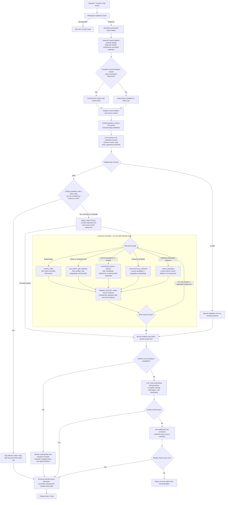

# Anime Watching Companion

A local anime assistant with a dedicated Gradio interface for setup and chat.
Prepare the AniList dataset, SQL search, entity dictionaries, and embeddings from
one screen, then ask about anime, characters, and recommendations.

The original multi-library GUI remains available. The previous README is preserved
in [README.backup-2026-10-14.md](README.backup-2026-10-14.md), including its custom
document, MultiDoc2Dial, VNDB, and CLI instructions.

## Start the GUI

Install Python 3.14 or newer, [uv](https://docs.astral.sh/uv/getting-started/installation/),
and [Ollama](https://ollama.com/download). Start the Ollama application, or leave
`ollama serve` running in another terminal.

From the repository root, on Windows PowerShell, macOS, or Linux:

```sh
uv sync
uv run python -m src.anilist_gui
```

Open **http://127.0.0.1:7861**. If that port is busy, the app selects the next
available port and prints the URL. After `uv sync`, the shorter entry point also works:

```sh
uv run anilist-gui
```

The browser interface handles dataset and model downloads. You do not need to run
the prepare or ingest CLI commands first. Python dependencies and the Ollama
application itself must be installed before launching the interface.

## Prepare the library

Click **Set up / resume**. The setup panel shows each stage and its elapsed time;
long downloads and embedding batches also report progress.

| Stage | What it does |
| --- | --- |
| Generation model | Checks the configured Ollama server and downloads the configured chat model if it is missing. |
| Dataset download | Reuses prepared data or a local raw dataset, otherwise downloads the AniList snapshot. |
| Prepare anime documents | Converts the CSV or ZIP into anime Markdown documents and a structured JSONL catalog. |
| SQL catalog and dictionaries | Builds or updates SQLite tables, full-text search, anime/character dictionaries, aliases, and genre/tag dictionaries. |
| Document embeddings | Loads the configured Sentence Transformers model, downloads it if needed, and builds the vector index. Reuses cached chunk embeddings. |
| Routing and feature embeddings | Prepares semantic tool guides and genre/tag embeddings used for routing and preference matching. |
| Verify workspace | Checks that the catalog and dictionaries contain data, validates vector shape and values, and checks that the chat model responds. |

Chat becomes available after verification succeeds. Setup writes a readiness
manifest so a later launch can recognize the same prepared assets and settings.
It does not download the full dataset or rebuild a verified index on every launch.
The Ollama server must still be running when you chat.

The dataset is a snapshot from
[calebmwelsh/anilist-anime-dataset on Kaggle](https://www.kaggle.com/datasets/calebmwelsh/anilist-anime-dataset),
not a live connection to your AniList account. Its release date, completeness,
and source descriptions determine which questions the assistant can answer.

### Use a local CSV or ZIP

Under **Setup options**, select **Optional local AniList CSV or ZIP**, then click
**Set up / resume**. The archive must contain `anilist_anime_data_complete.csv`
or exactly one CSV. The app reads CSV data; it does not execute scripts or load
pickles included in an archive.

The selected source is copied into the managed raw-data directory for retries and
tag-description lookup. Your original upload is preserved. Choosing a new source
prepares that dataset and rebuilds the indexes with available embedding caches.

If no upload is selected, setup looks for the raw dataset under `data/raw/` and
then the older `data-raw/` location. An existing prepared library can also be used
without downloading another raw copy.

### Resume or rebuild

If a stage fails, its error appears in the setup panel and terminal. Correct the
problem and click **Set up / resume** again. Setup reruns its checks and reuses
available downloads, prepared data, and committed embedding-cache batches. A failed
or interrupted setup does not leave a valid ready marker.

Select **Rebuild prepared data and indexes** when you want to regenerate the
prepared library from the retained raw source. This reuses the source rather than
fetching a newer release, and reuses unchanged embeddings when caching is enabled.
To import a different snapshot, select its CSV or ZIP explicitly.

Starting setup clears the current browser chat. Setup and chat requests run one
at a time to avoid modifying indexes during a query.

## Chat with the library

Try:

```text
What is Assassination Classroom about?
Who are the characters?
What should I watch after Steins;Gate?
Give me sad anime recommendations.
Recommend three comedy anime.
```

Recommendations default to five titles unless you request another count, subject
to available evidence. Cast answers include brief descriptions when biographies
are present. Missing information should be identified rather than invented.

Short follow-ups can use conversation history. Complete recommendation requests
without backward references start a fresh search; requests such as "sad anime
like that" retain their reference subject. **New chat** clears the visible history.

Answers use local source data, not live web searches. Small local models can still
make mistakes in interpretation, mood/tag selection, or wording; the debug view
shows what they selected and retrieved.

## Sample screenshots

These examples show AniList queries in the original chat interface. Browse all
images in [sample_screenshots/](sample_screenshots/).

### Recommendations after a reference anime


### A new recommendation request


### Synopsis followed by a character question


### 

## How queries flow

This is the active AniList chat path. Semantic routing retrieves tool guides and
genre/tag candidates; the planning model chooses the actual tools and arguments.



The normal path interprets the request, plans tools, then presents an answer.
Recommendation interpretation makes small semantic decisions per criterion,
so its LLM call count varies with request complexity. Verified recommendation
titles and synopsis excerpts are rendered directly from catalog records, so the
final wording cannot invent additional exclusions or substitute another title.
Factual questions normally
use three calls. Interpretation separates named entities, hard constraints,
and soft preferences. Constraints quote their user source, use canonical catalog
feature types, and are validated before retrieval. Preferences follow Genre,
then Tags, then semantic General Descriptions; factual dates, counts, runtime,
format and other structured attributes keep their own typed lookup path.
Recommendation tools share
this contract, and returned candidates are checked against it again before the
answer is generated. Subjective preferences use semantic ranking rather than
literal synopsis keyword filters. Broader category mappings and unrepresentable
requirements are disclosed in the answer. Invalid constraints are rejected
rather than silently ignored.

All tool steps are planned up front; a tool
result can supply IDs to later steps through references such as `$0.matches.0.id`.
Dependent steps run after their inputs are available, while failed dependencies
do not prevent unrelated steps from completing. An existing source bundle can
answer a simple question without additional tools.

The same planning call also decides request scope. Clearly unrelated questions
can receive a short, helpful reply written by the planner itself, without tool
execution or a second model call. This is not an automatic refusal. Uncertain
requests continue through the normal path; missing anime keywords or unknown
titles alone do not make a request irrelevant. Explicit anime references,
recommendation requests, contextual plans and planned tools prevent an early exit.

History supplies omitted references, not new constraints for an independent
request. A fresh mood-based search has no inherited seed; "anime like that" can
use the previous reference anime. Recommendations default to five, and cast
sections supply short biographies for character introductions.

Recommendations can combine exact `year` or inclusive `year_from`/`year_to`
(including open-ended ranges), studio, source material, staff name and credited
role, format, genres, and tags. The planner interprets the timeframe; code applies
the bounds without converting them into a fixed decade category. A reference
anime or genre is optional. `sort_by=score` ranks by the imported average score;
`sort_by=popularity` ranks by imported popularity. Missing metadata does not match
a requested filter, and empty results do not silently widen the criteria.
Production metadata from existing exports is indexed into SQL once without
changing documents or rebuilding embeddings.

Recommendations also accept general `filters`: an AND list of
`{"field":"episodes","operator":"lte","value":"13"}` objects. Values are
strings; numeric fields support `eq/ne/lt/lte/gt/gte`, and text/collection fields
support `eq/ne/contains/not_contains`. Available fields are discovered from the
imported data and supplied to the planner and its schema. These include counts,
per-episode duration, status, score, popularity, adult flag, season, country,
credits, character profiles, voice actors, relations and other export metadata.
Collection searches match individual leaf values; they do not imply that two
filters refer to the same nested member. Use `staff` with `staff_role` for a
credit by the same person. Unknown values do not satisfy numeric bounds.
`sort_by` supports score, popularity, year, episodes and duration, with
`sort_order=asc/desc`.

For vague measurements, RAG retrieves schema definitions and examples, and the
model interprets the corresponding numeric bounds. Calendar expressions such as
decades become inclusive release-year intervals; there are no decade phrase
parsers. Subjective brevity refers to episode count by default: eligibility is
capped at 50 episodes, with 10–19 episodes preferred. This policy is disclosed in
the answer, and the preferred range affects ranking rather than becoming a hard
category. Explicit per-episode runtime uses the separate duration field. Numeric
preferences are ranked in SQL before the result limit and retained during
semantic reranking. Unknown episode counts do not satisfy the ceiling.
Extra export fields are indexed once in SQLite; subsequent launches reuse them,
without rebuilding documents or embeddings. Large matching metadata lists are
reduced to relevant values before answer generation.

For open-ended tropes such as a protagonist turning villainous, the planner can
call `search_features` to semantically search existing tag names, definitions and
descriptive examples. Its result IDs feed into recommendations in the same plan,
without another LLM planning call. `tag_match=any` retrieves alternative tags for
one concept; the default `all` still combines separately required tags. The full
preference reranks these candidates. An empty feature search cannot silently
widen into an unfiltered recommendation. Tags identify candidates, not proof of
a particular character arc; the answer must distinguish documented details from
broader matches. Asking for a twist or arc permits its necessary spoilers.

Multi-title questions retain each distinct title mention, including a base title
named separately from a sequel with the same prefix. Compact per-work facts and
synopses survive prose-window trimming and later tool calls. The planner loads
evidence for all requested subjects; the answer model compares and reasons from
those records, keeping claims attributed to the correct work. The same flow
handles similarities, differences, factual questions and follow-ups without a
question-specific calculation or comparison tool.

Factual replies use a compact per-subject evidence packet and structured source
selection. Numerical replies let the model choose expressions and labels; a
bounded arithmetic renderer evaluates `+ - * /` over source measurements, carries
their units, and converts compatible time units. It contains no anime-length
formula or title-specific rules. Ordinary comparisons and explanations remain
model-written prose. The normal path still uses one planning call and one answer
call. Debug includes `answer_grounding` with selected facts and evaluated
expressions. A contradictory context flag cannot erase a previous subject group
explicitly selected by ID or a clear referential follow-up; assistant prose is
never used as source data. Missing source evidence cannot support a guessed count.

The implementation follows [anilist_setup.py](src/anilist_setup.py),
[rag.py](src/rag.py), [entity_agent.py](src/entity_agent.py), and
[tool_plan.py](src/tool_plan.py). The separate `SemanticRouter` in
`src/semantic_router.py` belongs to the retained legacy retrieval backend; it is
not an extra routing-model call in this AniList path. Stage timings and tool
results stream to the terminal as this flow progresses.

## Debug output

Keep the launching terminal open. Diagnostics print immediately as stages start
and finish, including the validated plan, individual tool arguments/results,
failures, and elapsed seconds. The final terminal message gives a request summary.

Expand **Processing debug** in the GUI to inspect the latest full request snapshot:

- `history_policy` and `use_previous_context`: how previous conversation was handled.
- `router_plan` and `selected_context`: planned work and selected entities.
- `scope`: `in_domain`, `out_of_domain`, or `uncertain`; `response_path` is
  `planner_direct_response` when the planner's reply skips tools and generation.
- `agent_trace`: executed tools, result summaries, and each tool's elapsed time.
- `timings_seconds`: context preparation, guide/feature lookup, planning, tools, and answer generation.
- `llm_calls`, `planned_tools`, `executed_tools`, and total `elapsed_seconds`.

The normal entity-agent path uses one planning call and one answer call. Identity
validation can request an additional correction. Setup also makes a small model
request during verification.

## Configuration

The app reads `settings.toml`. It always selects AniList explicitly, without
changing `[knowledge_base] default` for the original GUI or CLI. Model and device
choices come from this file; restart the app after changing them.

```toml
[models]
provider = "ollama"
llm = "llama3.2:3b"
embedding = "sentence-transformers/all-MiniLM-L6-v2"
embedding_device = "auto"
embedding_batch_size = 64
embedding_cache = true
embedding_cache_version = "1"
ollama_url = "http://localhost:11434"

[generation]
context_window = 8192
temperature = 0.2
max_tokens = 700
```

Keep the other existing sections in your TOML file. `auto` prefers CUDA, then MPS,
then CPU when available. Lower `embedding_batch_size` if GPU memory is insufficient.
Windows dependencies use the configured CUDA 12.8 PyTorch index; other platforms
use the platform-compatible PyTorch distribution. CPU mode remains available.

`RAG_LLM_MODEL`, `RAG_EMBEDDING_MODEL`, and `RAG_OLLAMA_URL` override the corresponding
model settings. Changes to the model, chunking, or index artifacts invalidate the
saved readiness signature; run setup again to verify or rebuild the affected assets.

Launch options:

```sh
uv run python -m src.anilist_gui --config settings.toml --host 127.0.0.1 --port 7861
```

The default server is local. The optional `--share` flag requests a public Gradio
share URL; omit it for normal local use.

## Generated files

| Location | Contents |
| --- | --- |
| `data/raw/anilist_anime_data_complete.csv` | Downloaded or imported raw data; the payload may be ZIP-wrapped. |
| `data/documents/anilist/anime-*.md` | Prepared documents. |
| `data/documents/anilist/catalog.jsonl` | Structured source catalog. |
| `data/documents/anilist/catalog.sqlite3` | SQL catalog, characters, relationships, dictionaries, and full-text passages. |
| `data/index/anilist/chunks.json` and `vectors.npy` | Passage metadata and vector index. |
| `data/index/anilist/embeddings.sqlite3` | Reusable chunk-embedding cache. |
| `data/index/anilist/entity-tools.sqlite3` | Tool-guide embedding cache. |
| `data/index/anilist/entity-features.sqlite3` | Genre/tag embedding cache. |
| `data/index/anilist/setup.json` | Successful-setup readiness signature. |

Embedding-model files use the normal Hugging Face/Sentence Transformers cache;
generation-model files are managed by Ollama. SQL and vectors serve different
purposes: catalog tools answer structured questions, while lexical and semantic
retrieval provide additional descriptive evidence.

## Troubleshooting

| Problem | Action |
| --- | --- |
| Cannot connect to Ollama | Start the Ollama app or `ollama serve`; check `ollama_url`; retry setup. |
| Dataset download fails or requires access | Obtain the dataset from its Kaggle page, select the CSV/ZIP in Setup options, and retry. |
| Model download fails | Check the configured model name, Ollama availability, connection, and disk space. Retry setup. |
| Embedding download fails | Allow the configured model to download from Hugging Face, or provide it in the local model cache, then retry. |
| GPU out of memory | Lower the embedding batch size or use `embedding_device = "cpu"`, restart, and resume setup. |
| Index verification fails | Select rebuild and rerun setup. Cached embeddings can be reused. |
| Chat is disabled | Complete setup successfully; inspect the failed stage if one is shown. |
| Existing data but no ready marker | Run setup once to check SQL, build missing caches, and verify the library. |

First setup can take time and needs disk space for both model files and the full
dataset/index. Progress reflects real downloads and batches; the app does not
estimate a fixed completion time.

## Existing GUI and CLI

The original GUI is preserved at its original entry point and default port:

```sh
uv run python -m src.gui
```

The existing AniList CLI remains available:

```sh
uv run rag prepare-anilist
uv run rag ingest --kb anilist
uv run rag ask "What should I watch after Steins;Gate?" --kb anilist --debug
uv run rag tool popular --kb anilist --limit 5
```

See the [backed-up README](README.backup-2026-10-14.md) for the original multi-library
workflows and dataset-specific commands.

## Factual RAG evaluation

Open [the hard-facts notebook](notebook/hard_facts_evaluation.ipynb) to inspect the
180-question benchmark and run real-model factual evaluation. A smaller 42-question
CLI dataset across six titles and seven fields is also provided:

```sh
uv run python -m src.factual_evaluation --output data/evaluation/factual/results/my_run
```

Add `--limit 3` for a smoke test. Each final response is independently extracted
through Ollama without exposing expected values to the extractor, then scored by
code. Identical runs resume saved checkpoints. Review extraction evidence before
interpreting scores. See [sample data and usage](data/evaluation/factual/README.md).

## Recommendation evaluation

Open [the recommendation notebook](notebook/recommendation_evaluation.ipynb) for
72 natural-language requests covering tags and moods, genres, release dates,
animation studios, formats, source material, lengths, and combined constraints.
Forty-eight requests use indirect wording. A separate LLM request extracts titles
from each real RAG answer; deterministic catalog checks score every recommendation.
Metrics include strict P@k, graded fit, nDCG, constraint coverage, duplicates, and
count adherence, with inline charts and per-item audits.

```sh
uv run python -m src.recommendation_evaluation --mode full --output data/evaluation/recommendations/results/full_001
```

The notebook selects the full 72-request benchmark and displays completed real-model
results by default. Set `RUN_LIVE=True` with a new run name to generate fresh full-run
answers. See [dataset and metric details](data/evaluation/recommendations/README.md).

## Development

Git includes source code, tests, notebooks with their saved outputs, and small
authored evaluation inputs. Downloaded corpora, prepared documents, indexes,
catalog-reference exports, logs, separate model responses, and exported charts stay local. Run the normal
knowledge-base setup to prepare application data. Recommendation evaluation also
requires `python scripts/build_recommendation_benchmark.py` after AniList setup;
that command intentionally refreshes the local snapshot labels and manifest.

Both published notebooks run in offline inspection mode without the excluded
catalogs, databases, raw data, indexes, or saved runs. Install dependencies with
`uv sync --extra evaluation`; dataset coverage then works from the checked-in inputs.
Saved outputs contain full real-model evaluations. No smoke or synthetic result is
substituted when local references/results are missing.
Live inference requires Ollama and the normal AniList app setup, which recreates
the excluded runtime assets rather than depending on copies from this machine.

To verify the source-only distribution and execute both notebooks in real kernels:

```sh
uv run python scripts/verify_offline_notebooks.py --source-only --tests
```

Verification writes separate copies under the ignored `data/notebook-output-backups/`
directory and leaves the published notebook outputs unchanged. Local diagnostic
replay tools capture a fresh baseline when old captures are absent; these live
diagnostics require the same model/setup as chat.

```sh
uv run python -m unittest discover -s tests
```

Setup tests use a tiny local dataset and stub model/network responses; they do not
download the full dataset or model weights.

### Team rules

- Create a pull request from a new branch for each contribution. Never push directly to main.
- At least one approval from another team member is required before merging.
- AI assistance and code review are welcome; experimentation and collaboration are encouraged.

Prior tooling notes: GitHub Copilot was used for pull request review, and Claude
for `/code-review --fix`.
