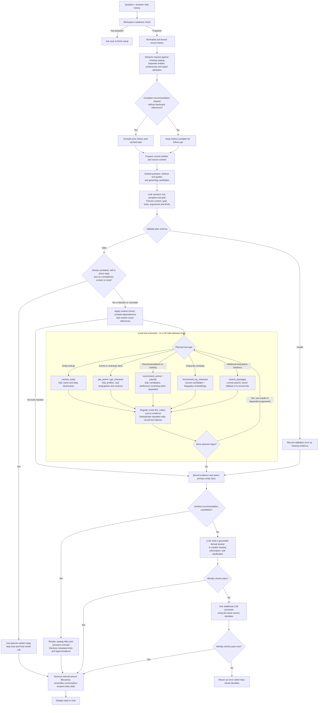

# Anime Watching Companion

An anime recommender that answers from the AniList catalog: recommendations, titles, characters and
their facts, grounded in catalog records instead of the model's memory. It runs on AWS behind the
sign-in page: a question goes to an API that queues it, a worker answers it with a Bedrock model over
a published catalog bundle, and the page shows the answer. Everything runs first on LocalStack, and
every answer is a trace in Phoenix (Arize AX on AWS).

```text
browser ─ CloudFront ─┬─ /       → S3 (web/)
                      └─ /api/*  → API Gateway (Cognito JWT) → api Lambda (src/chat/handler.py)
                                     POST /api/chat          → DynamoDB job + SQS message → 202 {job_id}
                                     GET  /api/chat/{job_id} → status and answer (the page polls)
SQS (+ dead-letter queue) → worker Lambda (container image, src/recommender/worker.py)
                              ├─ catalog bundle from S3 (the version named in SSM), cached in /tmp
                              ├─ MiniLM embeddings in ONNX Runtime, SQLite catalog, per-anime vectors
                              ├─ passage index: Aurora Serverless v2 + pgvector, through the RDS Data API
                              ├─ Bedrock: Qwen3 32B on bedrock-mantle (AWS), a stand-in or Ollama (LocalStack)
                              └─ answer and conversation turn → DynamoDB
```

The code is in [`src/recommender/`](src/recommender) and its tests in
[`tests/recommender/`](tests/recommender); the deployment is described in [INFRA.md](INFRA.md) and the
tests in [TESTING.md](TESTING.md). The README of the earlier local app (Gradio and Ollama) is kept in
[README.backup-2026-10-14.md](README.backup-2026-10-14.md).

## Try it locally

Needs Docker, [just](https://just.systems/), [uv](https://docs.astral.sh/uv/), OpenTofu, Terragrunt,
the AWS CLI and a LocalStack auth token (see [INFRA.md](INFRA.md#localstack-local-aws)). One command
starts LocalStack and Phoenix, deploys the stack, publishes the AniList catalog and registers you:

```sh
just local-up me@student.uu.se
just chat me@student.uu.se "What should I watch after Steins;Gate?"
just chat me@student.uu.se "Something shorter?" --conversation <id printed above>
```

LocalStack's Bedrock answers with Llama 3.2 3B, on the GPU once Docker can use it (see
[TESTING.md](TESTING.md#try-the-recommender-locally-and-see-its-traces)), otherwise on CPU in minutes.
CI uses a deterministic stand-in model instead (`RAG_LOCAL_MODEL_API=stub`). To try a stronger
model, ask in-process with any Bedrock model:

```sh
just recommender-build full          # the full AniList catalog (downloads it on first use)
MODEL_API=openai MODEL_ID=qwen.qwen3-32b AWS_PROFILE=... AWS_REGION=us-east-2 \
  TRACING_ENDPOINT=http://localhost:6006/v1/traces uv run recommender ask "What should I watch after Steins;Gate?" --kb anilist
```

## Build and release the catalog

The worker reads a versioned bundle: the SQLite catalog, the documents, one precomputed vector per
anime and the tool and feature embeddings, with `recommender.toml` and `prompts/`. `recommender build`
prepares them (download or local CSV/ZIP, documents, SQL catalog and dictionaries, embeddings,
verification) and writes `build/recommender/<version>/` with a manifest of every file's SHA-256. The
passage index (chunk texts in SQLite, their float16 vectors sorted by anime) stays next to the bundle,
in `passages/`: publishing loads it into the vector database. Unchanged chunks reuse their cached
embeddings, so a rebuild after a small change is quick. The worker opens the bundle as built: it never
rebuilds the catalog or embeds the catalog at request time.

```sh
just recommender-build fixture       # ten invented anime, seconds
just recommender-build full          # AniList (data/raw/anilist_anime_data_complete.csv, else download)
just recommender-publish full        # upload to the local stack and serve it
just aws-recommender-publish         # the same on AWS
just aws-recommender-activate 20261018T120000Z   # serve an older version again (rollback)
```

Publishing uploads the bundle and loads its passages into the table `chunks_<version>` of the vector
database (Aurora PostgreSQL with pgvector; LocalStack emulates it locally), then points the SSM
parameter `/<prefix>/recommender/artifact-version` at it. Workers check the parameter every five
minutes and download the new version into `/tmp`, verifying its checksum, so a release needs no
redeploy. The vector database keeps the passages of the three newest versions and the active one, which
is how far a rollback reaches.

Try:

```text
What is Assassination Classroom about?
Who are the characters?
What should I watch after Steins;Gate?
Give me sad anime recommendations.
Recommend three comedy anime.
```

Recommendations default to five titles unless you request another count, subject
to available evidence. Short follow-ups use the conversation's earlier turns; complete
recommendation requests without backward references start a fresh search; **New conversation** on
the page starts over.

## How queries flow

This is the active AniList chat path. Semantic routing retrieves tool guides and
genre/tag candidates; the planning model chooses the actual tools and arguments.



The normal path interprets the request, plans tools, then presents an answer.
Recommendation interpretation makes small semantic decisions per criterion,
so its LLM call count varies with request complexity. Verified recommendation
titles and synopsis excerpts are rendered directly from catalog records, so the
final wording cannot invent additional exclusions or substitute another title.
Factual questions normally
use three calls. Interpretation separates named entities, hard constraints,
and soft preferences. Constraints quote their user source, use canonical catalog
feature types, and are validated before retrieval. Preferences follow Genre,
then Tags, then semantic General Descriptions; factual dates, counts, runtime,
format and other structured attributes keep their own typed lookup path.
Recommendation tools share
this contract, and returned candidates are checked against it again before the
answer is generated. Subjective preferences use semantic ranking rather than
literal synopsis keyword filters. Broader category mappings and unrepresentable
requirements are disclosed in the answer. Invalid constraints are rejected
rather than silently ignored.

All tool steps are planned up front; a tool
result can supply IDs to later steps through references such as `$0.matches.0.id`.
Dependent steps run after their inputs are available, while failed dependencies
do not prevent unrelated steps from completing. An existing source bundle can
answer a simple question without additional tools.

The same planning call also decides request scope. Clearly unrelated questions
can receive a short, helpful reply written by the planner itself, without tool
execution or a second model call. This is not an automatic refusal. Uncertain
requests continue through the normal path; missing anime keywords or unknown
titles alone do not make a request irrelevant. Explicit anime references,
recommendation requests, contextual plans and planned tools prevent an early exit.

History supplies omitted references, not new constraints for an independent
request. A fresh mood-based search has no inherited seed; "anime like that" can
use the previous reference anime. Recommendations default to five, and cast
sections supply short biographies for character introductions.

Recommendations can combine exact `year` or inclusive `year_from`/`year_to`
(including open-ended ranges), studio, source material, staff name and credited
role, format, genres, and tags. The planner interprets the timeframe; code applies
the bounds without converting them into a fixed decade category. A reference
anime or genre is optional. `sort_by=score` ranks by the imported average score;
`sort_by=popularity` ranks by imported popularity. Missing metadata does not match
a requested filter, and empty results do not silently widen the criteria.
Production metadata from existing exports is indexed into SQL once without
changing documents or rebuilding embeddings.

Recommendations also accept general `filters`: an AND list of
`{"field":"episodes","operator":"lte","value":"13"}` objects. Values are
strings; numeric fields support `eq/ne/lt/lte/gt/gte`, and text/collection fields
support `eq/ne/contains/not_contains`. Available fields are discovered from the
imported data and supplied to the planner and its schema. These include counts,
per-episode duration, status, score, popularity, adult flag, season, country,
credits, character profiles, voice actors, relations and other export metadata.
Collection searches match individual leaf values; they do not imply that two
filters refer to the same nested member. Use `staff` with `staff_role` for a
credit by the same person. Unknown values do not satisfy numeric bounds.
`sort_by` supports score, popularity, year, episodes and duration, with
`sort_order=asc/desc`.

For vague measurements, RAG retrieves schema definitions and examples, and the
model interprets the corresponding numeric bounds. Calendar expressions such as
decades become inclusive release-year intervals; there are no decade phrase
parsers. Subjective brevity refers to episode count by default: eligibility is
capped at 50 episodes, with 10–19 episodes preferred. This policy is disclosed in
the answer, and the preferred range affects ranking rather than becoming a hard
category. Explicit per-episode runtime uses the separate duration field. Numeric
preferences are ranked in SQL before the result limit and retained during
semantic reranking. Unknown episode counts do not satisfy the ceiling.
Extra export fields are indexed once in SQLite; subsequent launches reuse them,
without rebuilding documents or embeddings. Large matching metadata lists are
reduced to relevant values before answer generation.

For open-ended tropes such as a protagonist turning villainous, the planner can
call `search_features` to semantically search existing tag names, definitions and
descriptive examples. Its result IDs feed into recommendations in the same plan,
without another LLM planning call. `tag_match=any` retrieves alternative tags for
one concept; the default `all` still combines separately required tags. The full
preference reranks these candidates. An empty feature search cannot silently
widen into an unfiltered recommendation. Tags identify candidates, not proof of
a particular character arc; the answer must distinguish documented details from
broader matches. Asking for a twist or arc permits its necessary spoilers.

Multi-title questions retain each distinct title mention, including a base title
named separately from a sequel with the same prefix. Compact per-work facts and
synopses survive prose-window trimming and later tool calls. The planner loads
evidence for all requested subjects; the answer model compares and reasons from
those records, keeping claims attributed to the correct work. The same flow
handles similarities, differences, factual questions and follow-ups without a
question-specific calculation or comparison tool.

Factual replies use a compact per-subject evidence packet and structured source
selection. Numerical replies let the model choose expressions and labels; a
bounded arithmetic renderer evaluates `+ - * /` over source measurements, carries
their units, and converts compatible time units. It contains no anime-length
formula or title-specific rules. Ordinary comparisons and explanations remain
model-written prose. The normal path still uses one planning call and one answer
call. Debug includes `answer_grounding` with selected facts and evaluated
expressions. A contradictory context flag cannot erase a previous subject group
explicitly selected by ID or a clear referential follow-up; assistant prose is
never used as source data. Missing source evidence cannot support a guessed count.

The implementation follows [anilist_setup.py](src/recommender/anilist_setup.py),
[rag.py](src/recommender/rag.py), [entity_agent.py](src/recommender/entity_agent.py), and
[tool_plan.py](src/recommender/tool_plan.py). The separate `SemanticRouter` in
`src/recommender/semantic_router.py` belongs to the retained legacy retrieval backend; it is
not an extra routing-model call in this AniList path. Each stage, tool call, model call and
retrieval is a span of the question's trace (see below).

## Debugging with traces

There is no debug output: every question is one trace, sent to Phoenix locally (`just phoenix-up`,
http://localhost:6006) and to Arize AX on AWS. The error the page shows carries the trace ID
("reference …"), and `recommender ask` prints it. A trace holds:

| Span | Kind | What it shows |
| --- | --- | --- |
| `api.ask` | chain | the question, user and conversation (`session.id`, which groups a conversation in Phoenix's Sessions view) |
| `recommender.job` | chain | the worker's attempt, bundle version and answer; failures with their exception |
| `download_artifacts`, `warm_recommender` | chain | a cold start: bundle size and download time |
| `EntityAgent.answer` | agent | events `history_selection`, `scope_decision`, `plan_ready` (with the plan and selected context) and the usage summary (`recommender.*`) |
| `interpret_request`, `planning`, `generate_answer`, … | chain | each stage of the pipeline, with its duration |
| `classify_mentions`, `plan_tools`, `agent_reply`, … | LLM | the messages, the reply, the model and token counts; `schema_validation_failed` events when a reply needed correcting |
| `recommend_anime`, `get_anime`, … | tool | the tool's arguments and a summary of its result |
| `vector_search`, `embed_query` | retriever, embedding | the retrieved chunks with their scores |

The evaluations capture the same spans in-process and save their summary in each checkpoint
(`debug_events`).

## Configuration

`recommender.toml` holds the catalog paths, chunking, retrieval and generation settings; it goes into
every bundle. The model and tracing come from the environment, as in the Lambdas:

| Variable | Meaning |
| --- | --- |
| `MODEL_API` | `openai` (Chat Completions on bedrock-mantle), `converse` (bedrock-runtime, also LocalStack) or `stub` |
| `MODEL_ID` | e.g. `qwen.qwen3-32b`, `us.amazon.nova-micro-v1:0`, `ollama.llama3.2:3b` (LocalStack) |
| `MODEL_TIMEOUT_SECONDS` | per model call (default 60) |
| `BEDROCK_ENDPOINT_URL` | Converse endpoint for the CLI, e.g. `http://localhost:4566` for LocalStack |
| `TRACING_ENDPOINT`, `TRACING_PROJECT` | OTLP endpoint (Phoenix or Arize) and project; empty turns tracing off |
| `EMBEDDING_MODEL_DIR` | where the pinned ONNX MiniLM lives (downloaded on first use; baked into the image) |
| `VECTOR_DB_CLUSTER_ARN`, `VECTOR_DB_SECRET_ARN`, `VECTOR_DB_NAME` | the passage index in Aurora (Data API); also `publish`'s `--vector-db-*` defaults |

Structured steps validate the model's JSON against their schema and ask once more with the
validation error, because LocalStack and several Bedrock models don't enforce schemas themselves.

## Generated files

| Location | Contents |
| --- | --- |
| `data/raw/anilist_anime_data_complete.csv` | Downloaded or imported raw data; the payload may be ZIP-wrapped. |
| `data/documents/anilist/anime-*.md` | Prepared documents. |
| `data/documents/anilist/catalog.jsonl` | Structured source catalog (the build's input; not bundled). |
| `data/documents/anilist/catalog.sqlite3` | SQL catalog, characters, relationships, dictionaries, and full-text passages. |
| `data/index/anilist/chunks.sqlite3` and `chunk-vectors.npy` | Passage index: chunk texts by id and their float16 vectors, sorted by anime so a filter is a slice. |
| `data/index/anilist/anime-texts.sqlite3` | One vector per anime, which recommendations rank by. |
| `data/index/anilist/embeddings.sqlite3` | Reusable chunk-embedding cache (not bundled). |
| `data/index/anilist/entity-tools.sqlite3`, `entity-features.sqlite3` | Tool-guide and genre/tag embeddings. |
| `build/recommender/<version>/` | Release bundles: `bundle.tar.zst`, `manifest.json` and `passages/` (loaded into the vector database). |

## Factual RAG evaluation

Open [the hard-facts notebook](notebook/hard_facts_evaluation.ipynb) to inspect the
180-question benchmark and run real-model factual evaluation. A smaller 42-question
CLI dataset across six titles and seven fields is also provided:

```sh
uv run python -m src.recommender.factual_evaluation --output data/evaluation/factual/results/my_run
```

Add `--limit 3` for a smoke test. Set `MODEL_API`, `MODEL_ID` (and `BEDROCK_ENDPOINT_URL` for
LocalStack) first: the pipeline and the extractor use that Bedrock model. Each final response is
independently extracted without exposing expected values to the extractor, then scored by
code. Identical runs resume saved checkpoints. Review extraction evidence before
interpreting scores. See [sample data and usage](data/evaluation/factual/README.md).

## Recommendation evaluation

Open [the recommendation notebook](notebook/recommendation_evaluation.ipynb) for
72 natural-language requests covering tags and moods, genres, release dates,
animation studios, formats, source material, lengths, and combined constraints.
Forty-eight requests use indirect wording. A separate LLM request extracts titles
from each real RAG answer; deterministic catalog checks score every recommendation.
Metrics include strict P@k, graded fit, nDCG, constraint coverage, duplicates, and
count adherence, with inline charts and per-item audits.

```sh
uv run python -m src.recommender.recommendation_evaluation --mode full --output data/evaluation/recommendations/results/full_001
```

The notebook selects the full 72-request benchmark and displays completed real-model
results by default. Set `RUN_LIVE=True` with a new run name to generate fresh full-run
answers. See [dataset and metric details](data/evaluation/recommendations/README.md).

## Development

Git includes source code, tests, notebooks with their saved outputs, and small
authored evaluation inputs. Downloaded corpora, prepared documents, indexes,
catalog-reference exports, logs, separate model responses, and exported charts stay local. Run the normal
`just recommender-build full` to prepare application data. Recommendation evaluation also
requires `python scripts/build_recommendation_benchmark.py` after AniList setup;
that command intentionally refreshes the local snapshot labels and manifest.

Both published notebooks run in offline inspection mode without the excluded
catalogs, databases, raw data, indexes, or saved runs. Install dependencies with
`uv sync --extra evaluation`; dataset coverage then works from the checked-in inputs.
Saved outputs contain full real-model evaluations. No smoke or synthetic result is
substituted when local references/results are missing.
Live inference requires a Bedrock model (`MODEL_API`, `MODEL_ID`) and `just recommender-build full`,
which recreates the excluded runtime assets rather than depending on copies from this machine.

To verify the source-only distribution and execute both notebooks in real kernels:

```sh
uv run python scripts/verify_offline_notebooks.py --source-only --tests
```

Verification writes separate copies under the ignored `data/notebook-output-backups/`
directory and leaves the published notebook outputs unchanged.

Run the recommender tests with:

```sh
just test-recommender
```

They need neither AWS nor a model: the Bedrock calls go to a scripted transport, and the build
tests use a tiny local dataset. The Lambda, LocalStack and OpenTofu module tests are described in
[TESTING.md](TESTING.md).

### Team rules

- Create a pull request from a new branch for each contribution. Never push directly to main.
- At least one approval from another team member is required before merging.
- AI assistance and code review are welcome; experimentation and collaboration are encouraged.

### GenAI used so far

- GitHub Copilot: pull request review.
- Claude (Anthropic): `/code-review --fix`, Claude Code and its VS Code plugin, and the
  [AWS Agent Toolkit](https://docs.aws.amazon.com/agent-toolkit/latest/userguide/plugins.html)
  (`aws-core` plugin), enabled for everyone in `.claude/settings.json`. Claude Code offers to
  install it when you first trust the repository. To install it manually, run
  `/plugin install aws-core@claude-plugins-official`, then `/reload-plugins`.

## Tracing the local RAG with Phoenix

The recommender's traces are described in [Debugging with traces](#debugging-with-traces). The separate
local RAG over your own documents ([`src/local/`](src/local), `uv run rag`) is traced too:
[Arize Phoenix](https://phoenix.arize.com/) shows a trace of every `ingest` and question: the
retrieved chunks, the prompt sent to Ollama, and the answer.
It runs in Docker next to LocalStack, so the compose file still needs `LOCALSTACK_AUTH_TOKEN` in
`infra/.env` (see [LocalStack](INFRA.md#localstack-local-aws)):

```sh
just phoenix-up                                              # UI on http://localhost:6006
export RAG_PHOENIX_ENDPOINT=http://localhost:6006/v1/traces  # or set [tracing] endpoint in settings.toml
uv run rag ask "What is in my documents?"                    # the CLI and the GUI both send traces
just phoenix-down                                            # stop it; traces stay in infra/.phoenix/
```

Tracing is off while the endpoint is empty. The chat Lambda on LocalStack is traced too (see
[TESTING.md](TESTING.md#try-the-chat-locally-and-see-its-traces)); on AWS it sends its traces to Arize AX
(see [INFRA.md](INFRA.md#traces-in-arize-ax)).

## Infrastructure

The sign-in page, the chat API and their deployment to LocalStack and real AWS are described in
[INFRA.md](INFRA.md).


## Ethical considerations

* [Not GDPR compliant](GDPR.md)
