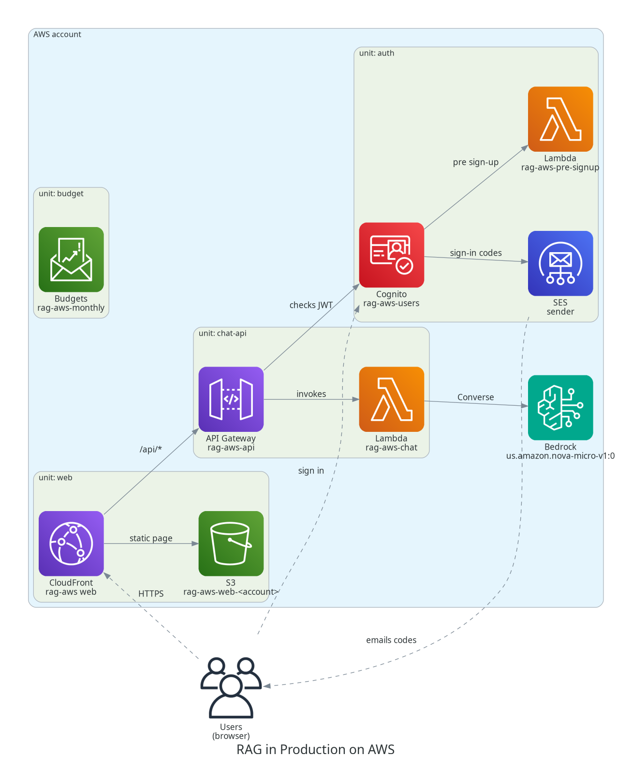

# Team rules

* Create a pull request from a new branch for each contribution.
  * Never push directly to main.
  * It requires at least one approval from another team member to merge.

* Feel free to use AI for anything, it is especially useful for code review.

* We embrace experimentation and collaboration; any idea is welcome.


# GenAI Used so far:

## GitHub Copilot

* Pull request review.

## Claude

* `/code-review --fix`
* [AWS Agent Toolkit](https://docs.aws.amazon.com/agent-toolkit/latest/userguide/plugins.html)
  (`aws-core` plugin): enabled for everyone in `.claude/settings.json`. Claude Code offers to
  install it when you first trust the repository. To install it manually, run
  `/plugin install aws-core@claude-plugins-official`, then `/reload-plugins`.

## Local RAG

This repository contains a configurable Retrieval-Augmented Generation application for local
documents. It uses Sentence Transformers for embeddings and Ollama for generation.

### Setup

Requires Python 3.14 or newer, `uv`, and [Ollama](https://ollama.com/).

#### Windows (PowerShell)

Install [uv](https://docs.astral.sh/uv/getting-started/installation/) and
[Ollama](https://ollama.com/download/windows), then start Ollama. From the repository root:

```powershell
uv sync
ollama pull llama3.2:3b
```

#### macOS (Terminal)

Install [uv](https://docs.astral.sh/uv/getting-started/installation/):

```bash
curl -LsSf https://astral.sh/uv/install.sh | sh
```

Restart Terminal so `uv` is available. Download [Ollama for macOS](https://ollama.com/download/mac),
install it in Applications, and launch it. Complete its first-run setup to enable the `ollama` command.
Keep Ollama running while using the app.

From the repository root, install Python and dependencies, download the model, and launch the GUI:

```bash
uv python install 3.14
uv sync
ollama pull llama3.2:3b
uv run python -m src.gui
```

If Ollama is installed but its server is not running, run `ollama serve` in a separate Terminal
window and leave it open. Skip this if the Ollama app is already running.

#### Using the app (Windows and macOS)

Put `.txt`, `.md`, `.pdf`, or `.docx` files in `data/documents`, then build the index and ask a
question:

```sh
uv run rag ingest
uv run rag ask "What is in my documents?"
```

To launch the browser interface:

```sh
uv run python -m src.gui
```

Open the URL printed in the terminal (normally `http://127.0.0.1:7860`). If the port is occupied,
the GUI automatically tries successive ports. Use `--port 8000` to start searching at another port. If no index exists, asking a question builds it automatically.
After adding documents, click **Rebuild index** to include them. The first ingest downloads the configured embedding model from
Hugging Face and caches it locally.

### Configuration

Edit `settings.toml` to change document and index paths, prompt, models, chunking, retrieval, and
generation settings. The environment variables `RAG_LLM_MODEL`, `RAG_EMBEDDING_MODEL`, and
`RAG_OLLAMA_URL` temporarily override model settings.

Use another TOML file with `--config path/to/settings.toml`. The provider boundary is
`src/providers.py`, so another local generation server can be integrated without
changing document loading, indexing, prompting, or the CLI.

## Infrastructure

Everything lives in [`infra/`](infra):

| Path | Contents |
| --- | --- |
| `infra/docker-compose.yml` | LocalStack, which emulates AWS locally |
| `infra/modules/s3-bucket/` | OpenTofu module for a private, versioned, encrypted S3 bucket, with tests in `tests/` |
| `infra/modules/auth/` | Cognito user pool with passwordless email-code sign-in, limited to allowed email domains |
| `infra/modules/chat-api/` | HTTP API with a Cognito JWT authorizer and a chat Lambda that answers with a Bedrock model |
| `infra/modules/web/` | Private S3 bucket and CloudFront for the page in [`web/`](web); `/api/*` is forwarded to the chat API |
| `infra/modules/budget/` | Monthly cost budget for the AWS account, emailing at 80 % actual and 100 % forecasted spend (real AWS only) |
| `infra/scripts/` | `local_flow.py` drives the local sign-in and chat flow; `diagram.py` draws the architecture diagram |
| `infra/live/` | Terragrunt config; `live/local/` deploys to LocalStack, `live/aws/` to your real AWS account |
| `web/` | Static sign-in and chat page (plain HTML, CSS and JavaScript; no build step) |

Requires [Docker](https://www.docker.com/), [just](https://just.systems/), the
[AWS CLI](https://aws.amazon.com/cli/), [OpenTofu](https://opentofu.org/),
[Terragrunt](https://terragrunt.gruntwork.io/) and [uv](https://docs.astral.sh/uv/) (it runs
the scripts in `infra/scripts/` with their dependencies). `just aws-diagram` also needs
[Graphviz](https://graphviz.org/download/) (`dot`). The versions are pinned in
`infra/.opentofu-version` and `infra/.terragrunt-version`; [tenv](https://github.com/tofuutils/tenv)
picks them up automatically.

### LocalStack (local AWS)

Create a free account at [app.localstack.cloud](https://app.localstack.cloud), copy your auth
token from **Auth Tokens**, and put it in `infra/.env`:

```sh
cp infra/.env.example infra/.env   # then set LOCALSTACK_AUTH_TOKEN
just up                            # start LocalStack and wait until it is healthy
just status                        # list the emulated services
just aws s3 ls                     # any AWS CLI command, sent to LocalStack
just down                          # stop it
```

### OpenTofu and Terragrunt

```sh
just lint             # formatting checks and validation of every module
just test-unit        # module tests with mocked providers, plus the Lambda unit tests (no LocalStack)
just test-localstack  # creates and destroys a test bucket on LocalStack
just plan             # plan infra/live/local
just apply            # deploy the whole stack (bucket, sign-in, chat API, page) on LocalStack
just e2e              # apply, run the sign-in and chat checks, then destroy
just destroy          # remove everything from infra/live/local
```

Run `just` to see all recipes.

### Trying the whole flow locally

`infra/live/local/` deploys the same `auth`, `chat-api` and `web` modules as `infra/live/aws/`
(both share `infra/live/_units/`). LocalStack's Cognito has no passwordless sign-in, so locally
users get a fixed password ([`infra/scripts/local_flow.py`](infra/scripts/local_flow.py)) and the
email-code screens can only be tried on real AWS. Everything else is exercised: the pre sign-up
Lambda's domain check, the confirmation code sent through SES, the JWT authorizer, the chat
Lambda's Bedrock call and CloudFront's `/api/*` forwarding.

LocalStack emulates Bedrock with a small open model (`qwen2.5:0.5b`, about 400 MB) that it runs
with Ollama on CPU, whatever model the request names: the local chat checks the whole path, not
the quality of the answers. The model is pulled and loaded when LocalStack starts, which takes a
minute or two the first time. Bedrock is part of LocalStack's paid plans, so the auth token must
include it.

```sh
just apply                                   # deploy
just outputs                                 # page URL (open it in a browser), API URL, IDs
just signup me@student.uu.se                 # register; the code is read from LocalStack's SES inbox
just codes                                   # every code LocalStack has "emailed"
just chat me@student.uu.se "What is week 3?" # sign in and ask through CloudFront
just session me@student.uu.se                # paste the output in the page's browser console
                                             # to sign the page in, then use the chat box
just destroy
```

LocalStack doesn't apply CloudFront's security headers (CSP, HSTS) or check the token issuer
strictly; check those on AWS.

### Real AWS: sign-in page and chat

`infra/live/aws/` deploys a sign-in page where people with an allowed university email
(`@uu.se`, `@student.uu.se` by default) register and sign in with a one-time code sent to
their inbox, then reach a chat box. The chat Lambda
([`infra/modules/chat-api/lambda/chat.py`](infra/modules/chat-api/lambda/chat.py)) answers with a
Bedrock model, Amazon Nova Micro by default (`RAG_BEDROCK_MODEL_ID` in `infra/.env` picks another).
It doesn't search the course documents yet; retrieval comes with the RAG backend.

```text
browser ── CloudFront ──┬── /        → S3 (web/)
   │                    └── /api/*   → API Gateway (JWT authorizer) → chat Lambda → Bedrock
   └── Cognito (email code; pre sign-up Lambda rejects other domains; codes sent through SES)
```



[`docs/architecture.png`](docs/architecture.png) is drawn by `just aws-diagram` from what is
deployed: each icon is a service in a unit's OpenTofu state, and each arrow means that service's
state refers to the other one (CloudFront's origins, the API's integration and authorizer,
Cognito's pre sign-up trigger, the chat Lambda's model). Run it again after `just aws-apply`
changes the services, and commit the new image.

One-time setup:

1. Sign in to your account with the AWS CLI, ideally through IAM Identity Center (`aws sso login`).
2. Fill in the "Real AWS" part of `infra/.env` (see `infra/.env.example`): `AWS_PROFILE`,
   `RAG_AWS_ACCOUNT_ID` and `RAG_SES_IDENTITY`. For a quick start, use your own email address
   as `RAG_SES_IDENTITY`; with a domain in Route 53, also set `RAG_ROUTE53_ZONE_ID`.
3. `just aws-bootstrap` creates the S3 bucket for the OpenTofu state.
4. `just aws-apply` deploys everything (CloudFront takes a few minutes). If you used an email
   address, click the verification link SES sends to it.
5. `just aws-outputs` prints the page URL.

New accounts start in the **SES sandbox**: codes only reach addresses verified in SES (at most
200 emails a day). Request production access in the SES console before inviting others, and set
`deletion_protection = "ACTIVE"` in `infra/live/aws/env.hcl` so registered users can't be deleted
by accident.

```sh
just aws-plan       # preview changes
just aws-apply      # deploy
just aws-outputs    # page URL, user pool and client IDs
just aws-destroy    # remove everything, including registered users
just web-dev        # serve web/ locally on http://localhost:8000 against the deployed API
just aws-diagram    # redraw docs/architecture.png from the deployed services
```

### CI

[`.github/workflows/infra.yml`](.github/workflows/infra.yml) runs on pull requests that touch
`infra/` or `web/`. The first job runs `just lint` and `just test-unit` (module tests with mocked
providers, plus the Lambda unit tests). The second job starts LocalStack
and runs `just test-localstack` and `just e2e`; it needs a `LOCALSTACK_AUTH_TOKEN` repository
secret (**Settings → Secrets and variables → Actions**) and is skipped without it, for example
on pull requests from forks.

### Ethical considerations

* GDPR-Compliant