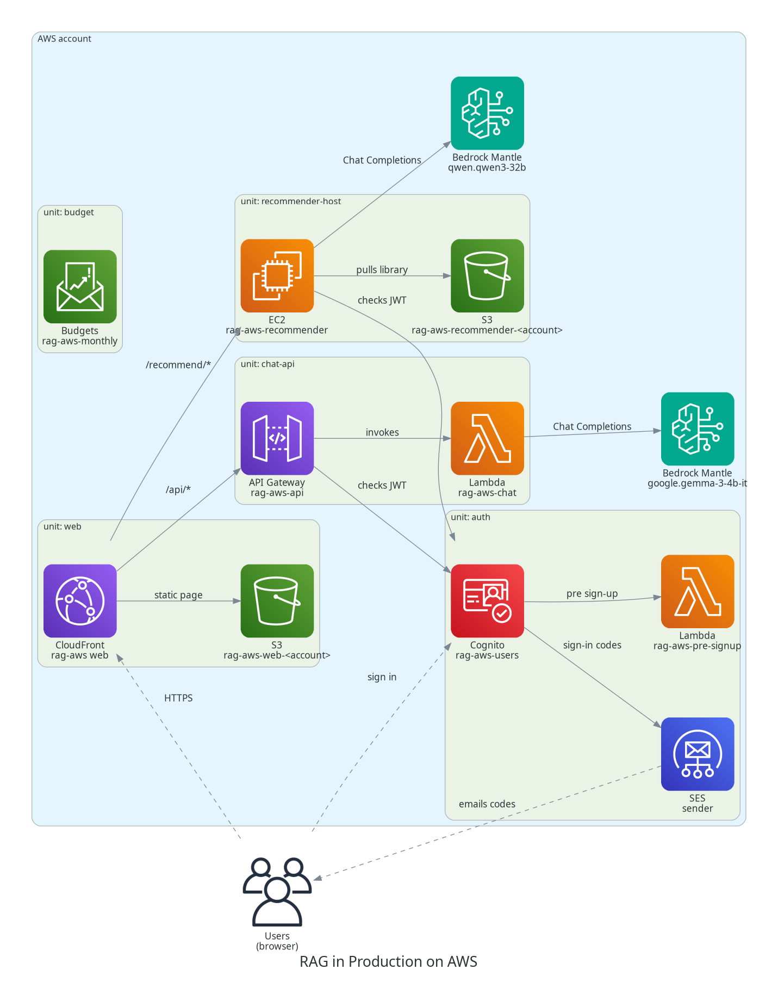

# Infrastructure

How the sign-in page, the chat and the anime recommender are deployed, on LocalStack and on real AWS.
To try them, see [testing](../testing.md).

The infrastructure lives in [`infra/`](../../infra); the Lambdas' code lives in [`src/`](../../src):

| Path | Contents |
| --- | --- |
| `infra/docker-compose.yml` | LocalStack, which emulates AWS locally, and Phoenix, which traces the local RAG, the local recommender service and the chat Lambda on LocalStack (on AWS the traces go to Arize AX) |
| `infra/modules/s3-bucket/` | OpenTofu module for a private, versioned, encrypted S3 bucket, with tests in `tests/` |
| `infra/modules/auth/` | Cognito user pool with passwordless email-code sign-in, limited to allowed email domains; the pre sign-up Lambda's code is in `src/auth/` |
| `infra/modules/chat-api/` | HTTP API with a Cognito JWT authorizer and a chat Lambda that answers with a Bedrock model; its code is in `src/chat/` |
| `infra/modules/web/` | Private S3 bucket and CloudFront for the page in [`web/`](../../web); `/api/*` is forwarded to the chat API and, when an instance runs, `/recommend/*` to the recommender |
| `infra/modules/recommender-host/` | EC2 instance (with an Elastic IP) that serves the anime recommender, its S3 data bucket, an instance role (read the bucket, call bedrock-mantle, SSM) and a security group open to CloudFront only; its code is in `src/recommender/` |
| `infra/modules/budget/` | Monthly cost budget for the AWS account, emailing at 80 % actual and 100 % forecasted spend (real AWS only); see the [monthly cost estimate](costs.md) |
| `infra/scripts/` | `local_flow.py` drives the local sign-in and chat flow; `diagram.py` draws the architecture diagram |
| `infra/live/` | Terragrunt config; `live/local/` deploys to LocalStack, `live/aws/` to your real AWS account |
| `web/` | Static sign-in and chat page (plain HTML, CSS and JavaScript; no build step) |
| `src/chat/`, `src/auth/` | Code of the chat Lambda and the pre sign-up Lambda, zipped by the modules above |
| `src/recommender/` | The anime recommender; `server.py` is the FastAPI service the instance runs, `bundle.py` publishes its library to the data bucket |
| `tests/` | Unit tests of the Lambdas (`just test-unit`) |

Requires [Docker](https://www.docker.com/), [just](https://just.systems/), the
[AWS CLI](https://aws.amazon.com/cli/), [OpenTofu](https://opentofu.org/),
[Terragrunt](https://terragrunt.gruntwork.io/) and [uv](https://docs.astral.sh/uv/) (it runs
the scripts in `infra/scripts/` with their dependencies). `just aws-diagram` also needs
[Graphviz](https://graphviz.org/download/) (`dot`). The versions are pinned in
`infra/.opentofu-version` and `infra/.terragrunt-version`; [tenv](https://github.com/tofuutils/tenv)
picks them up automatically. CI installs just at the version in `infra/.just-version`.

## LocalStack (local AWS)

Create a free account at [app.localstack.cloud](https://app.localstack.cloud), copy your auth
token from **Auth Tokens**, and put it in `infra/.env`:

```sh
cp infra/.env.example infra/.env   # then set LOCALSTACK_AUTH_TOKEN
just up                            # start LocalStack and wait until it is healthy
just status                        # list the emulated services
just aws s3 ls                     # any AWS CLI command, sent to LocalStack
just down                          # stop it
```

## OpenTofu and Terragrunt

```sh
just lint             # formatting checks and validation of every module
just test-unit        # module tests with mocked providers, plus the Lambda unit tests (no LocalStack)
just test-localstack  # creates and destroys a test bucket on LocalStack
just plan             # plan infra/live/local
just apply            # deploy the whole stack (bucket, sign-in, chat API, recommender bucket, page) on LocalStack
just e2e              # apply, run the sign-in and chat checks, then destroy
just destroy          # remove everything from infra/live/local
```

Run `just` to see all recipes.

## What LocalStack covers

`infra/live/local/` deploys the same `auth`, `chat-api` and `web` modules as `infra/live/aws/`
(both share `infra/live/_units/`). LocalStack's Cognito has no passwordless sign-in, so locally
users get a fixed password ([`infra/scripts/local_flow.py`](../../infra/scripts/local_flow.py)) and the
email-code screens can only be tried on real AWS. Everything else is exercised: the pre sign-up
Lambda's domain check, the confirmation code sent through SES, the JWT authorizer, the chat
Lambda's Bedrock call and CloudFront's `/api/*` forwarding.

LocalStack emulates Bedrock with a small open model (`qwen2.5:0.5b`, about 400 MB) that it runs
with Ollama on CPU, whatever model the request names, so it checks the path, not the quality of
the answers. Bedrock is part of LocalStack's paid plans, so the auth token must include it.
LocalStack doesn't apply CloudFront's security headers (CSP, HSTS) or check the token issuer
strictly; check those on AWS.

The steps to try the chat and the recommender locally are in [testing](../testing.md).

## Real AWS: sign-in page and chat

`infra/live/aws/` deploys a sign-in page where people with an allowed university email
(`@uu.se`, `@student.uu.se` by default) register and sign in with a one-time code sent to
their inbox, then reach a chat box. The chat Lambda
([`src/chat/handler.py`](../../src/chat/handler.py)) answers with a
Bedrock model: by default Gemma 3 4B through Chat Completions on bedrock-mantle, Bedrock's
OpenAI-compatible endpoint. Its quotas are separate from bedrock-runtime's, and the requests show
up under the default project in the console. The Lambda signs these requests with its IAM role,
so there is no API key to store. `RAG_BEDROCK_MODEL_ID` in `infra/.env` picks another model for
the chat Lambda, and `RAG_BEDROCK_MODEL_API=converse` switches it to Converse on bedrock-runtime,
which is what LocalStack emulates. The recommender has its own model, Qwen3 32B
(`RAG_RECOMMENDER_MODEL_ID`, see [below](#the-anime-recommender-on-ec2)); while its instance runs, the
page sends every message to the recommender, so the chat Lambda's model only answers when it doesn't. It doesn't search the course documents yet; retrieval comes with the RAG backend.

```text
browser ── CloudFront ──┬── /            → S3 (web/)
   │                    ├── /api/*       → API Gateway (JWT authorizer) → chat Lambda → Bedrock
   │                    └── /recommend/* → EC2 recommender (checks the JWT) → Bedrock; library from S3
   └── Cognito (email code; pre sign-up Lambda rejects other domains; codes sent through SES)
```



[`architecture.png`](architecture.png) is drawn by `just aws-diagram` from what is
deployed: each icon is a service in a unit's OpenTofu state, and each arrow means that service's
state refers to the other one (CloudFront's origins, the API's integration and authorizer,
Cognito's pre sign-up trigger, the chat Lambda's model, and the bucket, user pool and model named
in the recommender instance's boot script). Run it again after `just aws-apply`
changes the services, and commit the new image.

One-time setup:

1. Sign in to your account with the AWS CLI, ideally through IAM Identity Center (`aws sso login`).
2. Fill in the "Real AWS" part of `infra/.env` (see `infra/.env.example`): `AWS_PROFILE`,
   `RAG_AWS_ACCOUNT_ID` and `RAG_SES_IDENTITY`. For a quick start, use your own email address
   as `RAG_SES_IDENTITY`; with a domain in Route 53, also set `RAG_ROUTE53_ZONE_ID`.
3. `just aws-bootstrap` creates the S3 bucket for the OpenTofu state.
4. `just aws-apply` deploys everything (CloudFront takes a few minutes). If you used an email
   address, click the verification link SES sends to it.
5. `just aws-outputs` prints the page URL.

New accounts start in the **SES sandbox**: codes only reach addresses verified in SES (at most
200 emails a day). Request production access in the SES console before inviting others, and set
`deletion_protection = "ACTIVE"` in `infra/live/aws/env.hcl` so registered users can't be deleted
by accident.

```sh
just aws-plan       # preview changes
just aws-apply      # deploy
just aws-outputs    # page URL, user pool and client IDs
just aws-destroy    # remove everything, including registered users
just web-dev        # serve web/ locally on http://localhost:8000 against the deployed API
just aws-diagram    # redraw docs/infra/architecture.png from the deployed services
```

### The anime recommender on EC2

`infra/live/aws/recommender-host/` runs the recommender ([`src/recommender/`](../../src/recommender)) on one
EC2 instance, `t4g.medium` by default (2 vCPU, 4 GB, about $25 a month on demand; it serves about
30 chatting users, since the models run on Bedrock). systemd runs `recommender serve`, a FastAPI
service that checks the user's Cognito access token itself and answers under `/recommend/*`;
CloudFront forwards that path to the instance's Elastic IP over HTTP on port 8080, and the security
group lets only CloudFront's origin-facing addresses in. Replies stream keepalive lines so long
answers fit CloudFront's 60-second read timeout. Every LLM step goes to `qwen.qwen3-32b` through
Chat Completions on bedrock-mantle (it must follow JSON schemas); the embeddings run on the
instance. There is no SSH: the instance is reached through SSM Session Manager.

At boot the instance installs the package wheel from `releases/` in its data bucket and pulls the
library (about 1 GB) from `recommender/`, so publish both before or right after the first apply:

```sh
just recommender-setup        # build the library locally (once; reused while its inputs don't change)
just aws-apply                # deploys the recommender-host unit with the rest
just aws-recommender-publish  # upload the wheel and the library to the data bucket
just aws-recommender-deploy   # install the latest wheel on the instance and restart it (through SSM)
just aws-recommender-stop     # stop the instance between sessions (it then costs only its disk and IP)
just aws-recommender-start
```

`infra/.env` tunes it: `RAG_RECOMMENDER_INSTANCE=false` keeps the bucket, role and security group
but runs no instance (and leaves `/recommend/*` out of CloudFront), `RAG_RECOMMENDER_INSTANCE_TYPE`
and `RAG_RECOMMENDER_MODEL_ID` pick the instance and the model. The page asks the recommender
instead of the chat API when its `config.js` enables it, which the `web` module does whenever an
instance runs.

Locally, LocalStack holds only the data bucket (and the role and security group): its Bedrock
doesn't enforce JSON schemas, so the service runs on your machine with Ollama; see
[testing](../testing.md#try-the-anime-recommender-locally).

### Traces in Arize AX

A Lambda in AWS can't reach the Phoenix on your machine, so on AWS the chat Lambda sends its traces
to [Arize AX](https://app.arize.com) instead: the same `answer` and LLM spans as on LocalStack, under
the project **rag-aws**. The recommender instance sends its `recommender.ask` traces there too, with
the same space ID and key. The Arize API key is kept in SSM Parameter Store as a SecureString
(`/rag-aws/arize-api-key`), never in `infra/.env`, the OpenTofu state or the Lambda's environment;
the Lambda reads it when it starts and may read no other parameter.

1. Set `RAG_ARIZE_SPACE_ID` in `infra/.env`: the ID after `/spaces/` in your Arize URL.
2. `just aws-arize-key` asks for the API key (Arize: Space Settings > API Keys) and stores it.
   Run it again to rotate the key; running Lambdas pick up the new one on their next cold start.
3. `just aws-apply`, then send a message and open the project in Arize.

Tracing stays off while `RAG_ARIZE_SPACE_ID` is empty. If no traces appear, the Lambda's log
(`/aws/lambda/rag-aws-chat` in CloudWatch) says why, e.g. `Tracing off: could not read ...`.

## A second AWS account: only the budget

If you also call Bedrock by hand from another account, `infra/live/aws-mantle/` gives it the
same monthly budget as the chatbot's account (`RAG_BUDGET_LIMIT_USD`, `RAG_BUDGET_EMAILS`). Like
the original budget, it only sends emails and never stops anything. Set up a CLI profile for that
account with permission for AWS Budgets and S3. Set `RAG_MANTLE_AWS_PROFILE` and
`RAG_MANTLE_AWS_ACCOUNT_ID` in `infra/.env`, then:

```sh
just aws-mantle bootstrap   # state bucket in that account (once)
just aws-mantle plan        # preview
just aws-mantle apply       # create the rag-mantle-monthly budget
just aws-mantle destroy     # remove it
```

## CI

[`.github/workflows/infra.yml`](../../.github/workflows/infra.yml) runs on pull requests that touch
`infra/` or `web/`. The first job runs `just lint` and `just test-unit` (module tests with mocked
providers, plus the Lambda unit tests). The second job starts LocalStack
and runs `just test-localstack` and `just e2e`; it needs a `LOCALSTACK_AUTH_TOKEN` repository
secret (**Settings → Secrets and variables → Actions**) and is skipped without it, for example
on pull requests from forks.
