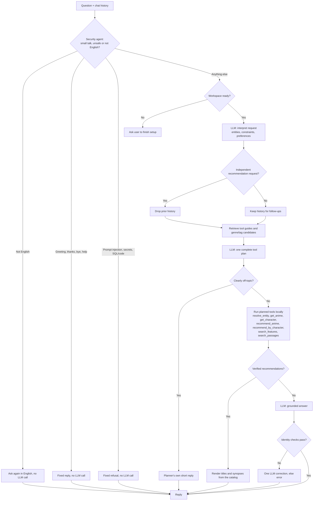

# Anime recommender

A local anime assistant with a Gradio interface for setup and chat. It prepares the AniList
dataset, an SQL catalog, entity dictionaries and embeddings from one screen, then answers
questions about anime, characters and recommendations. Code in [`src/recommender/`](../../src/recommender),
tests in [`tests/recommender/`](../../tests/recommender). The same package runs as the deployed
service on EC2 (see [infra](../infra/README.md#the-anime-recommender-on-ec2)).

## Start the GUI

Install Python 3.14+, [uv](https://docs.astral.sh/uv/getting-started/installation/) and
[Ollama](https://ollama.com/download), and keep Ollama running (the app or `ollama serve`). From
the repository root:

```sh
uv sync
uv run anilist-gui   # same as: uv run python -m src.recommender.anilist_gui
```

Open **http://127.0.0.1:7861** (the next free port if it is busy). `just recommender-gui` does the
same and also starts Phoenix for tracing. The interface downloads the dataset and models itself;
no CLI step is needed first.

## Prepare the library

Click **Set up / resume**. The panel shows each stage, its elapsed time and progress:

| Stage | What it does |
| --- | --- |
| Generation model | Checks Ollama and pulls the configured chat model if missing. |
| Dataset download | Reuses prepared or local raw data, otherwise downloads the AniList snapshot. |
| Prepare anime documents | Converts the CSV/ZIP into Markdown documents and a JSONL catalog. |
| SQL catalog and dictionaries | Builds SQLite tables, full-text search, anime/character/genre/tag dictionaries and aliases. |
| Document embeddings | Builds the vector index with Sentence Transformers, reusing cached chunk embeddings. |
| Routing and feature embeddings | Embeds tool guides and genre/tag descriptions used for routing and preference matching. |
| Verify workspace | Checks the catalog, dictionaries and vectors, and that the chat model responds. |

Chat is enabled once verification succeeds. A readiness manifest lets later launches skip setup
while the assets and settings are unchanged. `just recommender-setup` runs the same setup from the
terminal.

The data is a snapshot of
[calebmwelsh/anilist-anime-dataset on Kaggle](https://www.kaggle.com/datasets/calebmwelsh/anilist-anime-dataset),
not a live AniList connection.

- **Local CSV or ZIP:** under **Setup options**, pick the file (it must contain
  `anilist_anime_data_complete.csv` or exactly one CSV), then **Set up / resume**. Without one,
  setup looks in `data/raw/`, then `data-raw/`.
- **Resume:** after a failed stage, fix the problem and click **Set up / resume** again; finished
  downloads, data and embedding batches are reused.
- **Rebuild:** **Rebuild prepared data and indexes** regenerates everything from the retained raw
  source (unchanged embeddings are reused).

## Chat

```text
What is Assassination Classroom about?
Who are the characters?
What should I watch after Steins;Gate?
Give me sad anime recommendations.
Recommend three comedy anime.
```

Recommendations default to five titles. Short follow-ups use the conversation history; a complete
new recommendation request starts a fresh search, while "sad anime like that" keeps its reference.
**New chat** clears the history. Answers come only from the local data, and small local models can
still misread a request; the debug view shows what was selected and retrieved.


More examples in [sample_screenshots/](../../sample_screenshots/).

## How a question is answered



- **Security agent:** [security_agent.py](../../src/recommender/security_agent.py) reviews each
  message with rules before anything else runs. English is the only supported language: a message
  in another language (mostly non-Latin script, or more function words of Swedish, Spanish, French,
  German, Portuguese or Dutch than of English) gets a fixed request to ask in English; romaji and
  native titles inside an English question still pass. Whole-message small talk (greetings, thanks,
  goodbyes, "what can you do?") gets a fixed reply; prompt injection, requests for secrets and
  SQL/code injection get one refusal that doesn't say which rule matched. Neither costs an LLM
  call, an embedding or a catalog lookup, and the conversation's subjects carry over, so "thanks"
  followed by "something similar?" still knows the title. A greeting followed by a real question
  ("Hi, what should I watch after Monster?") goes through the normal path. The debug view shows
  `response_path: security_agent` and `security_category`.
- **LLM calls:** request interpretation (one or a few small calls, depending on the request), one
  planning call and one answer call, plus one optional correction when the answer mixes up
  identities. Tools run locally between them, with no LLM calls.
- **Planning:** all tool steps are planned up front; later steps take IDs from earlier results
  (`$0.matches.0.id`). Failed dependencies don't stop unrelated steps.
- **Filters:** recommendations combine years and ranges, studio, source, staff and role, format,
  genres, tags and generic `filters` (`{"field":"episodes","operator":"lte","value":"13"}`), sorted
  by score, popularity, year, episodes or duration. Missing metadata never matches a filter, and
  empty results are not silently widened.
- **Grounding:** recommendation titles and synopses are rendered from catalog records; factual
  answers use per-subject evidence, and arithmetic over source values is evaluated by code.
- **Entities:** names are classified from context before dictionary lookup; see
  [entity resolution](entity-resolution.md).

Main files: [anilist_setup.py](../../src/recommender/anilist_setup.py),
[rag.py](../../src/recommender/rag.py), [entity_agent.py](../../src/recommender/entity_agent.py),
[tool_plan.py](../../src/recommender/tool_plan.py). `semantic_router.py` belongs to the legacy
retrieval backend, not to this path.

## Debug and tracing

The terminal prints a summary per request with its `trace_id`. Expand **Processing debug** in the
GUI for the latest snapshot: `history_policy`, `router_plan`, `scope`, `agent_trace` (tools,
results, timings), `timings_seconds`, `llm_calls` and `elapsed_seconds`. The CLI prints the same as
JSON on stderr with `--debug`.

[Arize Phoenix](https://phoenix.arize.com/) shows every question as a trace: a span per stage
(`interpret_request`, `planning`, `generate_answer`, ...), per tool, per LLM call (with messages and
token counts) and per passage search. The `just` recipes start Phoenix and send traces to the
project `recommender` (UI on http://localhost:6006; the compose file needs `LOCALSTACK_AUTH_TOKEN`
in `infra/.env`, see [infra](../infra/README.md#localstack-local-aws)):

```sh
just recommender-ask "Who is the main character of Re:Zero?"   # --debug adds the routing summary
just recommender-gui
just phoenix-down                                              # traces stay in infra/.phoenix/
```

Without `just`, set `RAG_PHOENIX_ENDPOINT=http://localhost:6006/v1/traces` (or `[tracing] endpoint`
in `settings.toml`); tracing is off while it is empty. On AWS the traces go to Arize AX.

Every span carries the code's release (`RELEASE` in `src/recommender/__init__.py`, see
[RELEASES.md](../../RELEASES.md)) in its metadata. To see one release's traces, filter the Phoenix
span list with `metadata["release"] == "v0.0.2"`.

## Configuration

Settings come from `settings.toml`; restart after changing them.

```toml
[models]
provider = "ollama"          # or "bedrock" (bedrock-mantle, see [bedrock])
llm = "llama3.2:3b"
embedding = "sentence-transformers/all-MiniLM-L6-v2"
embedding_device = "auto"    # CUDA, then MPS, then CPU
embedding_batch_size = 64    # lower it if GPU memory runs out
embedding_cache = true

[generation]
context_window = 8192
```

`RAG_LLM_MODEL`, `RAG_EMBEDDING_MODEL`, `RAG_OLLAMA_URL` and `RAG_PROVIDER` override them. Changing
the model, chunking or index invalidates the readiness manifest; run setup again. On Windows,
`uv sync` installs CUDA 12.8 PyTorch; other platforms use the default build.

GUI options: `--config settings.toml --host 127.0.0.1 --port 7861`; `--share` asks Gradio for a
public URL.

Every setting is checked when it loads (and by `dataclasses.replace`): a bad value stops the start
with a validation error naming the setting and the rule, such as `router_top_k` and "Input should be
greater than or equal to 2".

### LLM calls: retries and timeouts

Each LLM call (Ollama or Bedrock) is retried on throttling (429), a 500/502/503/504 or a dropped or
timed-out connection, with exponential backoff and jitter; a `Retry-After` header sets the wait
instead. Other errors, such as a 400, fail at once. Every retry is an `llm_retry` event on the step's
span, and when the attempts run out the web service still reports a final 429 as "busy".

```toml
[llm]
max_attempts = 4
backoff_seconds = 1
max_backoff_seconds = 20
connect_timeout = 5   # seconds; reading the answer keeps each step's own timeout
```

### Prompts

The instructions of every LLM step are Jinja2 templates in
[`src/recommender/prompts/`](../../src/recommender/prompts), one file per step or correction (for
example `plan_tools.j2`, `answer.j2`, `agent_step.j2`, `route_plan.j2`); the code passes in only the
data (JSON evidence, the question, flags such as `final` or `grounded`). `tools.json` holds the tool
descriptions the planner reads, and `classify_mentions_examples.json` the few-shot examples for
mention classification. A template is sent exactly as written, minus the file's final newline, and a
missing value is an error rather than an empty gap.

The templates ship in the wheel, so each code release has the instructions its steps expect. To
change them without a code change, copy a template into a folder and name the folder in
`settings.toml`; files there replace the packaged ones with the same name, and `recommender publish`
ships the folder with the settings:

```toml
[paths]
prompt_overrides = "prompts/overrides"
```

The older `prompts/answer.txt`, `clarify.txt`, `routes.json` and `features.json` stay where they were.

## Generated files

| Location | Contents |
| --- | --- |
| `data/raw/anilist_anime_data_complete.csv` | Raw dataset |
| `data/documents/anilist/` | `anime-*.md` documents, `catalog.jsonl`, `catalog.sqlite3` (SQL catalog, dictionaries, full-text passages) |
| `data/index/anilist/` | `chunks.json` + `vectors.npy` (vector index), embedding caches (`*.sqlite3`), `setup.json` (readiness) |

Embedding models use the Hugging Face cache; chat models are managed by Ollama.

## Troubleshooting

| Problem | Action |
| --- | --- |
| Cannot connect to Ollama | Start Ollama, check `ollama_url`, retry setup. |
| Dataset download fails | Download the CSV from Kaggle, select it in Setup options, retry. |
| Model or embedding download fails | Check the model name, connection and disk space, retry. |
| GPU out of memory | Lower `embedding_batch_size` or set `embedding_device = "cpu"`, restart, resume. |
| Index verification fails | Select rebuild and run setup again. |
| Chat is disabled | Finish setup; check the failed stage. |

## CLI

```sh
uv run recommender setup                     # same as the GUI's Set up / resume
uv run recommender ask "What should I watch after Steins;Gate?" --kb anilist --debug
uv run recommender tool popular --kb anilist --limit 5   # tools: popular, recommend, title, character
uv run recommender serve                     # the FastAPI service the EC2 instance runs (port 8080)
```

### Other knowledge bases

The older multi-library GUI and the vector-only pipeline still support `custom` (your files in
`data/documents/custom`), `multidoc2dial` and `vndb` next to `anilist`:

```sh
uv run python -m src.recommender.gui         # pick the knowledge base under Advanced (port 7860)
uv run recommender select-kb vndb            # save [knowledge_base] default (now "anilist")
uv run recommender prepare-multidoc2dial     # or prepare-vndb [--source dump] [--spoiler-level 0-2]
uv run recommender ingest --kb multidoc2dial
uv run recommender ask "How do VA education benefits work?" --kb multidoc2dial
```

## Evaluation

- **Factual:** [hard-facts notebook](../../notebook/hard_facts_evaluation.ipynb) (180 questions),
  or the 42-question CLI run
  `uv run python -m src.recommender.factual_evaluation --output data/evaluation/factual/results/my_run`
  (`--limit 3` for a smoke test). See [its README](../../data/evaluation/factual/README.md).
- **Recommendations:** [recommendation notebook](../../notebook/recommendation_evaluation.ipynb)
  (72 requests; P@k, nDCG, constraint coverage), or
  `uv run python -m src.recommender.recommendation_evaluation --mode full --output data/evaluation/recommendations/results/full_001`.
  Needs `python scripts/build_recommendation_benchmark.py` after setup. See
  [its README](../../data/evaluation/recommendations/README.md).

Both notebooks open offline with their saved outputs (`uv sync --extra evaluation`); live runs need
Ollama and a finished setup. `uv run python scripts/verify_offline_notebooks.py --source-only --tests`
executes them without touching the published outputs.

Run the tests with `just test-recommender` (stub models, no downloads).
